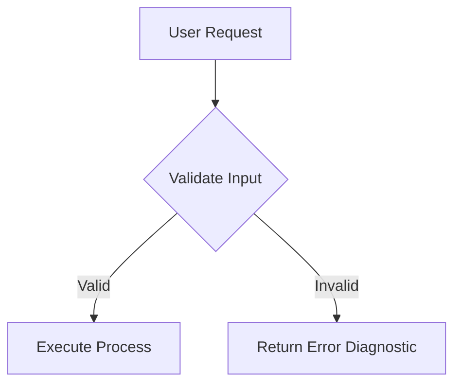

# Markdown Architect: Flawless Markdown Engineering

This skill provides comprehensive instructions, standards, and checklists for generating complete, rich, and visually crisp Markdown (`.md`) documents that render flawlessly across all viewers (GitHub, VS Code, One Markdown, Obsidian, Glow, etc.) on the first try.

---

## 1. Core Principles: First-Try Perfection

1. **No Lazy Placeholders**: Never use `<!-- TODO: fill in -->`, `...`, `[rest of document here]`, or truncated sections unless explicitly asked. Produce complete, exhaustive content.
2. **Deterministic Syntax & Zero Collisions**: Protect table pipes, preserve URL brackets, and avoid unescaped characters that break AST parsers.
3. **No Raw LaTeX Math Delimiters**: Never use raw LaTeX delimiters (`$...$`, `$$...$$`, `\frac{}{}`, `\sum`, `\text{}`). Always use monospace formula blocks and clean native Unicode symbols.
4. **Resilient Typography**: Standardize heading hierarchies (`#` -> `##` -> `###`), fence language specifiers, and enforce proper table alignments.

---

## 2. Table Engineering Standards

Tables frequently break in Markdown due to unescaped pipes (`|`), linebreaks, or inconsistent header separators.

### Rules for Flawless Tables:
1. **Always Include Column Headers & Alignment Row**:
   ```markdown
   | Parameter | Type | Default | Description |
   | :--- | :---: | :---: | :--- |
   | `timeout` | `number` | `5000` | Request timeout in milliseconds |
   | `retries` | `number` | `3` | Number of automatic retries |
   ```
2. **Escape Pipes Inside Cells**:
   - If a cell contains a logical OR or pipe symbol, escape it with `\|` or enclose it in a code span:
   - Correct: `string \| number` or `` `string | number` ``
   - Broken: `string | number`
3. **No Multiline Strings Inside Cells**:
   - Use `<br>` for intentional linebreaks within a single table cell.
   - Example: `First line<br>Second line`

---

## 3. Mathematical, Financial & Logical Expressions

Follow the native Unicode and monospace standard for 100% viewer compatibility:

### Monospace Formula Blocks
For multi-step arithmetic, proofs, equations, matrix summaries, or financial models, use fenced code blocks:

```
Total Margin = ∑ (Revenue_k - Cost_k) / Total Revenue
             = ($150,000 - $90,000) / $150,000
             = $60,000 / $150,000 = 40.0%
```

```
ΔProfit = (-8 hrs × $10.00/hr) + (+30 yds × $5.00/yd)
        = -$80 + $150
        = +$70.00
```

### Native Unicode Palette
Use native Unicode glyphs inline and in headings:
- **Inequalities & Approximations**: `≤`, `≥`, `≠`, `≈`, `±`, `√N`
- **Arithmetic & Sets**: `×`, `÷`, `∑`, `∏`, `∈`, `∉`, `⊂`, `∪`, `∩`, `∅`
- **Logic & Flow**: `→`, `⇒`, `↔`, `⇔`, `∴`, `∵`
- **Greek & Physics/Stats**: `Δ`, `μ`, `σ`, `λ`, `α`, `β`, `θ`, `π`, `ω`
- **Subscripts / Superscripts**: `x₁`, `x₂`, `x*`, `n²`, `e⁻ˣ`

### Currency Formatting
- Wrap currency values in backtick code spans: `$10.00/hr`, `-$8.00`, `$5.00/yd`.
- Never use `$value$` or `$$value$$`.

---

## 4. Code Blocks, Fencing & Language Tags

1. **Always Specify Language Identifiers**:
   - Good: ````bash`, ````lua`, ````typescript`, ````json`, ````yaml`, ````text`
   - Never leave anonymous ```` blocks unless intentionally plain text.
2. **Nested Code Blocks (Fencing)**:
   - When demonstrating Markdown inside Markdown, use 4 backticks (````markdown) for the outer wrapper so inner 3-backtick blocks render safely without premature closing.
3. **Clean Diff Highlighting**:
   - Use `diff` language tags for modifications:
     ```diff
     - const oldConfig = false;
     + const newConfig = true;
     ```

---

## 5. Visual Hierarchy & Formatting Elements

### Callouts and Alerts
Use GitHub-compliant alert syntax:
```markdown
> [!NOTE]
> Explanatory note or background context.

> [!TIP]
> Practical advice, keyboard shortcuts, or performance optimizations.

> [!IMPORTANT]
> Key requirement or prerequisite that must not be skipped.

> [!WARNING]
> Breaking change, common pitfall, or potential hazard.
```

### Diagrams (Mermaid)
Always wrap Mermaid diagrams in fenced ````mermaid` blocks with quoted node labels to prevent syntax parser errors:


### Checklists & Task Lists
Ensure standard brackets with clean spacing:
- [x] Completed task item
- [ ] Pending task item

---

## 6. Pre-Flight Verification Checklist

Before outputting or committing any Markdown document:

- [ ] **Completeness**: All sections are fully fleshed out with no placeholder comments.
- [ ] **Math / Equations**: Zero raw LaTeX math delimiters (`$`, `$$`, `\frac`, etc.); all formulas are cleanly formatted with Unicode or monospace blocks.
- [ ] **Table Integrity**: Header rows, divider colons, escaped cell pipes (`\|`), and `<br>` for cell breaks.
- [ ] **Code Spans**: Backticks used for variable names, inline currency, parameters, paths, and CLI commands.
- [ ] **Fence Matching**: All open code blocks (````) are properly matched and closed with valid language identifiers.
- [ ] **Link Validation**: All markdown links follow standard `[Text](URI)` or clickable `[file.txt](file:///path/to/file)` format.
