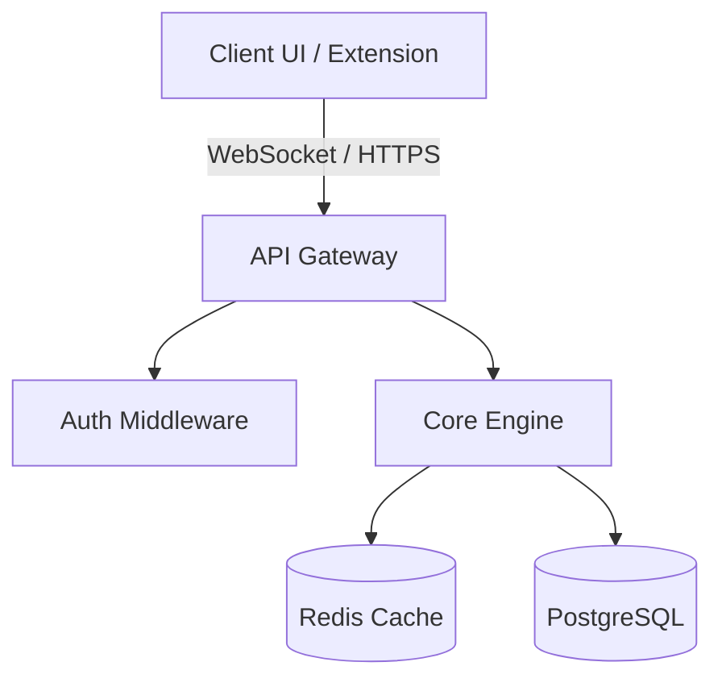
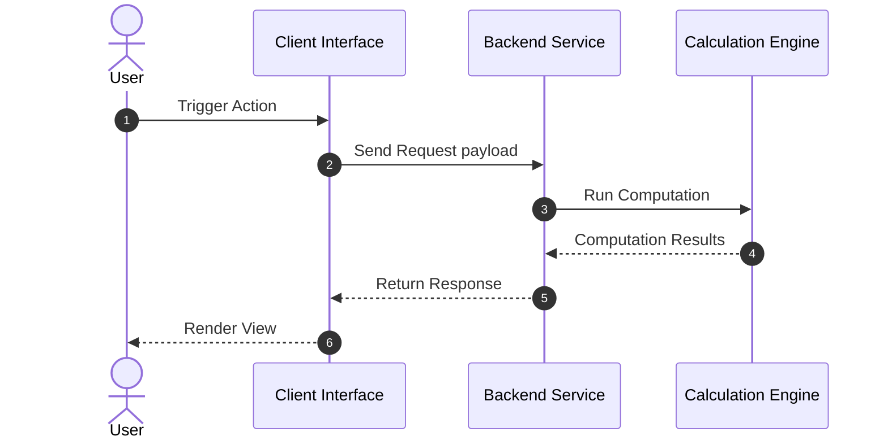
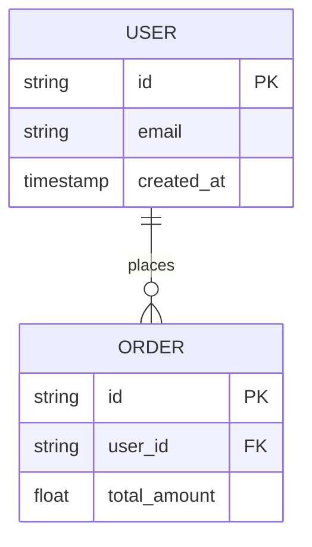

# Mermaid Architecture Designer

Generate clean, valid Mermaid diagrams to visualize distributed systems, state transitions, sequence workflows, and entity relationships.

## Key Diagram Types

### 1. System Architecture / Flow

### 2. Sequence Workflow

### 3. Entity-Relationship Schema

