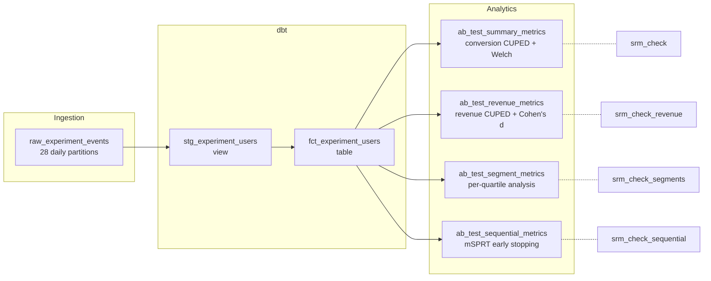

# A/B Testing Pipeline — Dagster + dbt + DuckDB

A production-grade experimentation pipeline that generates synthetic telemetry, transforms it with dbt, and runs statistically rigorous hypothesis tests — all orchestrated as declarative data assets in Dagster.

## Architecture



## Quickstart

```bash
# Create environment (requires Python 3.10-3.12)
uv venv --python 3.12
source .venv/bin/activate
uv pip install -e ".[dev]"

# Launch Dagster UI
dagster dev
```

Open http://localhost:3000, click **Materialize All**, and watch the pipeline run.

## Statistical Methods

| Method | Purpose | Asset |
|--------|---------|-------|
| SRM chi-square | Detect randomization failure (blocking check) | All |
| CUPED | Variance reduction via pre-experiment covariate | Summary, Revenue |
| Welch's t-test | Unequal-variance hypothesis test | Summary, Revenue, Segments |
| Cohen's h / d | Effect size (binary / continuous) | Summary / Revenue |
| Post-hoc power | Detect underpowered experiments | Summary, Revenue |
| Gaussian-mixture mSPRT | Always-valid sequential testing for early stopping | Sequential |

## Scheduling

- **Daily schedule**: runs all analytics assets at 06:00 UTC
- **Sensor**: triggers on DuckDB file modification (simulates new data arrival)
- **Partitions**: ingestion is partitioned by day (28 daily partitions starting 2026-07-01)

## Testing

```bash
pytest
```

26 tests covering:
- Unit tests for all statistical functions (SRM, CUPED, Welch, CI, effect sizes, mSPRT)
- Integration tests for partitioned ingestion (idempotency, accumulation)
- Integration tests for analytics assets via `dagster.materialize` with temp DuckDB

## Project Structure

```
├── ab_testing_dagster/
│   ├── assets.py          # Ingestion, dbt assets, summary metrics, schedule, sensor
│   ├── analytics.py       # Revenue, segment, sequential metrics + SRM checks
│   ├── stats_utils.py     # Pure statistical functions (no Dagster imports)
│   └── definitions.py     # Dagster Definitions entrypoint
├── dbt_project/
│   └── models/
│       ├── staging/       # stg_experiment_users (view)
│       └── marts/         # fct_experiment_users (table)
├── tests/
│   ├── test_stats_utils.py
│   └── test_pipeline.py
├── docs/                  # Detailed documentation
└── pyproject.toml
```

## Documentation

See [`docs/`](docs/) for:
- [Architecture](docs/architecture.md) — system design and data flow
- [Statistics](docs/statistics.md) — mathematical foundations
- [Assets](docs/assets.md) — asset reference
- [dbt Models](docs/dbt-models.md) — SQL transformations
- [Setup](docs/setup.md) — detailed installation guide
- [Operations](docs/operations.md) — running and troubleshooting
- [Guide](docs/GUIDE.md) — beginner-friendly walkthrough

## Tech Stack

| Component | Version | Role |
|-----------|---------|------|
| Dagster | ~1.13.15 | Orchestration |
| dagster-dbt | ~0.29.15 | dbt integration |
| dbt-duckdb | ~1.10.1 | SQL transformations |
| DuckDB | ~1.5.5 | Embedded analytics DB |
| NumPy / SciPy | ~2.5 / ~1.18 | Statistical computation |
| Pandas | ~3.0.5 | Data manipulation |
