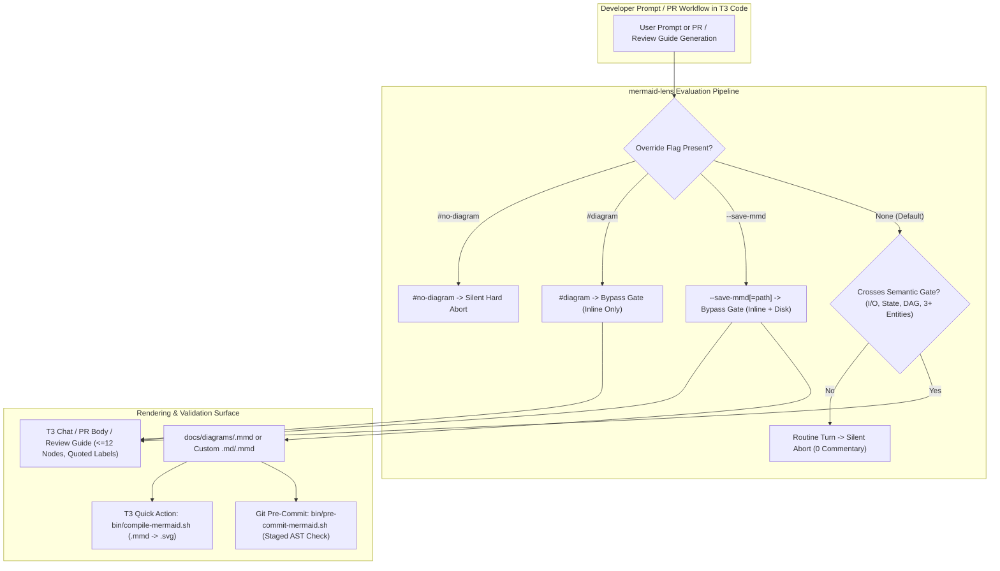

# T3 Code Ephemeral Architecture Diagramming (`mermaid-lens`) — Design Specification

- **Date**: 2026-10-21
- **Status**: Approved
- **Branch**: `feat/t3-code-mermaid-lens`
- **Worktree**: [`/Users/alex/Github/ne1cc/terminal-configs/.worktrees/feat-t3-code-mermaid-lens`](file:///Users/alex/Github/ne1cc/terminal-configs/.worktrees/feat-t3-code-mermaid-lens)

---

## 1. Executive Summary & Goals

Software engineers reviewing complex multi-file implementations, async workflows, or Pull Requests inside [T3 Code (Beta).app](file:///Applications/T3%20Code%20(Beta).app) benefit from immediate visual topology maps, whereas naive diagram generation on every turn or writing `.mmd` files by default causes token bloat and git worktree pollution.

This specification defines **`mermaid-lens`**, an **Ephemeral Inline Mental-Model Pattern** across all T3 Code provider families (`claude`, `codex`, `antigravity`, and `opencode`), T3's native PR and Review Guide engine, T3's Quick Action toolbar, and Git pre-commit validation:

1. **`mermaid-lens` Skill ([`.gemini/skills/mermaid-lens/SKILL.md`](file:///Users/alex/Github/ne1cc/terminal-configs/.worktrees/feat-t3-code-mermaid-lens/.gemini/skills/mermaid-lens/SKILL.md))**:
   - **Token Precedence Override Matrix**: Deterministic prompt flags (`#diagram`, `--save-mmd`, `--save-mmd=<path>`, `#no-diagram`) evaluated *before* the semantic complexity gate.
   - **Silent Semantic Complexity Gate (Default Mode)**: Silently aborts (zero commentary) on boilerplate/isomorphic CRUD, mechanical refactors/renames, iterative bug-fix loops, or linear diffs readable in `< 10` seconds. Proceeds *only* on cross-boundary I/O, state machines/concurrency locks, complex multi-branch DAGs/pipelines, or `3+` interconnected schema models.
   - **Context-Aware Diagram Selection**: Auto-selects `sequenceDiagram` (with actor lifelines and `activate`/`deactivate`), `stateDiagram-v2`, `flowchart LR`/`TD`, or `erDiagram`.
   - **Strict Rendering & Syntax Invariants**: Inline ephemeral default, hard cap at **12 nodes** and **3 subgraphs/actors**, simple alphanumeric IDs (never reserved keywords `end`, `graph`, `subgraph`, `flowchart`), mandatory double-quoted labels (`AuthSvc["Auth Service (JWT)"]`), `[NEW]`/`[MODIFIED]` delta prefixes, and a 1-sentence mental-model caption.
2. **Global Instruction & PR Mapping Integration**:
   - Wire `Post-Implementation & PR Visualization (mermaid-lens)` into all 6 global instruction files ([`AGENTS.md`](file:///Users/alex/Github/ne1cc/terminal-configs/.worktrees/feat-t3-code-mermaid-lens/AGENTS.md), [`.codex/AGENTS.md`](file:///Users/alex/Github/ne1cc/terminal-configs/.worktrees/feat-t3-code-mermaid-lens/.codex/AGENTS.md), [`.opencode/AGENTS.md`](file:///Users/alex/Github/ne1cc/terminal-configs/.worktrees/feat-t3-code-mermaid-lens/.opencode/AGENTS.md), [`claude-code/CLAUDE.md`](file:///Users/alex/Github/ne1cc/terminal-configs/.worktrees/feat-t3-code-mermaid-lens/claude-code/CLAUDE.md), [`.gemini/GEMINI.md`](file:///Users/alex/Github/ne1cc/terminal-configs/.worktrees/feat-t3-code-mermaid-lens/.gemini/GEMINI.md), and [`.qoder/QODER.md`](file:///Users/alex/Github/ne1cc/terminal-configs/.worktrees/feat-t3-code-mermaid-lens/.qoder/QODER.md)) while keeping every file strictly `< 18,000` bytes (under T3's `20,000`-byte `MAX_INSTRUCTION_FILE_CHARS` limit).
   - Wire `mermaid-lens` into T3's `sourceControlWritingStyle` and `reviewGuideInstructions` in [`~/.t3/userdata/settings.json`](file:///Users/alex/.t3/userdata/settings.json) so PR descriptions and T3 Review Guides automatically map architectural deltas.
3. **T3 Code Custom Quick Action (`Compile Diagrams`)**:
   - Create [`bin/compile-mermaid.sh`](file:///Users/alex/Github/ne1cc/terminal-configs/.worktrees/feat-t3-code-mermaid-lens/bin/compile-mermaid.sh) to validate AST syntax (`mmdc -i <file> -o /dev/null`) and compile `.mmd` files in `docs/diagrams/` (or specified paths) to `.svg` side-by-side.
   - Register `compile-mermaid-diagrams` (`Compile Diagrams`, icon `"build"`) in `defaultProjectScripts` inside [`~/.t3/userdata/settings.json`](file:///Users/alex/.t3/userdata/settings.json).
4. **Git Pre-Commit Hook for Staged `.mmd` Validation**:
   - Create [`bin/pre-commit-mermaid.sh`](file:///Users/alex/Github/ne1cc/terminal-configs/.worktrees/feat-t3-code-mermaid-lens/bin/pre-commit-mermaid.sh) and wire it into `.git/hooks/pre-commit` via [`bin/link-agent-skills.sh`](file:///Users/alex/Github/ne1cc/terminal-configs/.worktrees/feat-t3-code-mermaid-lens/bin/link-agent-skills.sh) so staged `.mmd` files are AST-checked via `mmdc` before commit (`0ms` overhead when no `.mmd` files are staged).

---

## 2. System Architecture

---

## 3. Verification Criteria

1. [`.gemini/skills/mermaid-lens/SKILL.md`](file:///Users/alex/Github/ne1cc/terminal-configs/.worktrees/feat-t3-code-mermaid-lens/.gemini/skills/mermaid-lens/SKILL.md) exists with valid YAML frontmatter and is symlinked across all agent skill directories (`~/.t3/skills`, `~/.agents/skills`, `~/.claude/skills`, `~/.claude-secondary/skills`, `~/.codex/skills`, `~/.config/opencode/skills`, `~/.opencode/skills`, `~/.gemini/config/skills`, and `~/.t3/userdata/providers/antigravity/*/config/skills`).
2. All 6 instruction files include `Post-Implementation & PR Visualization (mermaid-lens)` and remain `< 18,000` bytes.
3. [`bin/compile-mermaid.sh`](file:///Users/alex/Github/ne1cc/terminal-configs/.worktrees/feat-t3-code-mermaid-lens/bin/compile-mermaid.sh) and [`bin/pre-commit-mermaid.sh`](file:///Users/alex/Github/ne1cc/terminal-configs/.worktrees/feat-t3-code-mermaid-lens/bin/pre-commit-mermaid.sh) validate valid `.mmd` syntax (exit `0`) and reject corrupt `.mmd` syntax (exit `1`).
4. [`~/.t3/userdata/settings.json`](file:///Users/alex/.t3/userdata/settings.json) includes `compile-mermaid-diagrams` in `defaultProjectScripts` and updated `sourceControlWritingStyle` / `reviewGuideInstructions` with zero T3 schema errors in [`~/.t3/userdata/logs/server.trace.ndjson`](file:///Users/alex/.t3/userdata/logs/server.trace.ndjson).
