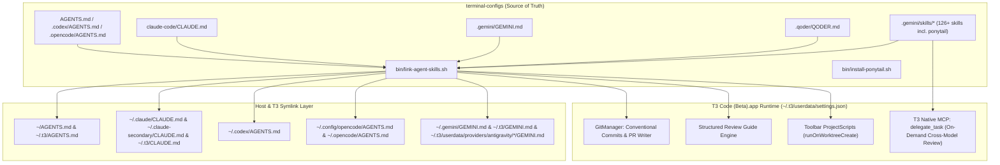

# T3 Code Quality Harnesses & Unified Provider Parity — Design Specification

- **Date**: 2026-10-21
- **Status**: Validated (Brainstorming Complete)
- **Branch**: `feat/t3-code-quality-harnesses`
- **Repository**: [`terminal-configs`](file:///Users/alex/Github/ne1cc/terminal-configs/.worktrees/feat-t3-code-quality-harnesses)

---

## 1. Executive Summary & Goals

[T3 Code (Beta).app](file:///Applications/T3%20Code%20(Beta).app) orchestrates four AI coding provider families on this workstation (`claude`, `codex`, `antigravity`, and `opencode` using the `zai-coding-plan` GLM model), plus T3's internal source-control and PR review guide generator. Historically, coding standards added to [`terminal-configs`](file:///Users/alex/Github/ne1cc/terminal-configs/.worktrees/feat-t3-code-quality-harnesses) (such as PR #41 Ponytail, PR #42 Fenced Mermaid Diagrams, PR #43 High-Signal Code Commenting & Walkthrough Standard, and PR #44 Clickable Absolute `file://` Links) drifted across provider instruction files or failed to reach T3's isolated provider instances (`~/.t3/userdata/providers/antigravity/<hash>/`, `~/.claude-secondary`, `~/.opencode/`).

This design establishes a **single, automated, schema-safe configuration and quality harness** across all T3 Code providers and native T3 Code subsystems:

1. **100% Rule Parity Across All 6 Instruction Files**: Harmonize [`AGENTS.md`](file:///Users/alex/Github/ne1cc/terminal-configs/.worktrees/feat-t3-code-quality-harnesses/AGENTS.md), [`.codex/AGENTS.md`](file:///Users/alex/Github/ne1cc/terminal-configs/.worktrees/feat-t3-code-quality-harnesses/.codex/AGENTS.md), [`.opencode/AGENTS.md`](file:///Users/alex/Github/ne1cc/terminal-configs/.worktrees/feat-t3-code-quality-harnesses/.opencode/AGENTS.md), [`claude-code/CLAUDE.md`](file:///Users/alex/Github/ne1cc/terminal-configs/.worktrees/feat-t3-code-quality-harnesses/claude-code/CLAUDE.md), [`.gemini/GEMINI.md`](file:///Users/alex/Github/ne1cc/terminal-configs/.worktrees/feat-t3-code-quality-harnesses/.gemini/GEMINI.md), and [`.qoder/QODER.md`](file:///Users/alex/Github/ne1cc/terminal-configs/.worktrees/feat-t3-code-quality-harnesses/.qoder/QODER.md) so every provider enforces identical standards while remaining strictly under T3's `20,000`-byte (`MAX_INSTRUCTION_FILE_CHARS`) limit.
2. **Complete Symlink Topology for All T3 Provider Instances**: Extend [`bin/link-agent-skills.sh`](file:///Users/alex/Github/ne1cc/terminal-configs/.worktrees/feat-t3-code-quality-harnesses/bin/link-agent-skills.sh) and [`bin/install-ponytail.sh`](file:///Users/alex/Github/ne1cc/terminal-configs/.worktrees/feat-t3-code-quality-harnesses/bin/install-ponytail.sh) to link `~/AGENTS.md`, `~/.t3/{AGENTS.md,CLAUDE.md,GEMINI.md,skills}`, `~/.opencode/{AGENTS.md,opencode.json,skills}`, and every T3 Antigravity ACP provider instance directory (`~/.t3/userdata/providers/antigravity/*/`).
3. **T3 Native Quality Engine Configuration**: Atomically merge `reviewGuidesEnabled`, `reviewGuideInstructions`, `sourceControlWritingStyle`, `branchNamingMode`, and `branchNameInstructions` into [`~/.t3/userdata/settings.json`](file:///Users/alex/.t3/userdata/settings.json) using strict Effect Schema literals so T3's live file watcher (`watchFileChanges`) reloads without overwriting GUI preferences.
4. **T3 Toolbar Actions (`defaultProjectScripts`)**: Register three 1-click toolbar scripts in [`~/.t3/userdata/settings.json`](file:///Users/alex/.t3/userdata/settings.json) (`Sync & Link Providers` with `runOnWorktreeCreate: true`, `Ponytail Debt`, and `Verify Configs & Links`).
5. **On-Demand Cross-Provider Adversarial Review**: Enhance [`.gemini/skills/ponytail-review/SKILL.md`](file:///Users/alex/Github/ne1cc/terminal-configs/.worktrees/feat-t3-code-quality-harnesses/.gemini/skills/ponytail-review/SKILL.md) and [`.gemini/skills/code-review/SKILL.md`](file:///Users/alex/Github/ne1cc/terminal-configs/.worktrees/feat-t3-code-quality-harnesses/.gemini/skills/code-review/SKILL.md) to leverage T3's native `delegate_task` MCP tool for cross-model verification strictly on-demand when requested by the user.

### Explicit Non-Goals (YAGNI Cuts)
- **No separate `code-commenter` skill file**: The High-Signal Code Commenting & Walkthrough Standard (from PR #43, commit `796c226`) lives inline inside the global instruction files, not as a separate skill.
- **No `repo-summarize` toolbar button**: Cut from T3 `defaultProjectScripts` as not relevant to the core T3 Code workflow.
- **No unused provider drivers**: Cursor and GitHub Copilot are unused in T3 and excluded from provisioning.
- **No automatic multi-agent review on every commit/PR**: Cross-provider review via `delegate_task` runs strictly on-demand to preserve token budgets.

---

## 2. System Architecture & Topology



---

## 3. Component Design

### 3.1 Component 1: Instruction File Harmonization & 20 KB Budget Enforcement

#### Technical Constraint (`app.asar` Discovery)
In T3 Code's `GitManager.readRepositoryInstructions` (`app.asar` lines `905038–905046`), T3 enforces two hard limits when reading `AGENTS.md` or `CLAUDE.md`:
1. `MAX_INSTRUCTION_FILE_CHARS = 20000`: Any instruction file with `info.size > 20000` bytes is silently dropped (`return Option.none()`).
2. `realPath` containment check: Symlinks pointing outside a project repo (`relative.startsWith("..")`) are ignored by T3's repo instruction reader, though CLI harnesses (`claude`, `codex`, `agy`, `opencode`) read their global home files directly without this restriction.

#### Canonical 11-Rule Matrix
Every global instruction file in [`terminal-configs`](file:///Users/alex/Github/ne1cc/terminal-configs/.worktrees/feat-t3-code-quality-harnesses) ([`AGENTS.md`](file:///Users/alex/Github/ne1cc/terminal-configs/.worktrees/feat-t3-code-quality-harnesses/AGENTS.md), [`.codex/AGENTS.md`](file:///Users/alex/Github/ne1cc/terminal-configs/.worktrees/feat-t3-code-quality-harnesses/.codex/AGENTS.md), [`.opencode/AGENTS.md`](file:///Users/alex/Github/ne1cc/terminal-configs/.worktrees/feat-t3-code-quality-harnesses/.opencode/AGENTS.md), [`claude-code/CLAUDE.md`](file:///Users/alex/Github/ne1cc/terminal-configs/.worktrees/feat-t3-code-quality-harnesses/claude-code/CLAUDE.md), [`.gemini/GEMINI.md`](file:///Users/alex/Github/ne1cc/terminal-configs/.worktrees/feat-t3-code-quality-harnesses/.gemini/GEMINI.md), and [`.qoder/QODER.md`](file:///Users/alex/Github/ne1cc/terminal-configs/.worktrees/feat-t3-code-quality-harnesses/.qoder/QODER.md)) will be updated so all 6 files contain the complete 11-section standard while staying strictly `< 18,000` bytes (`2,000+` bytes safety margin below `20,000` bytes):

| # | Section | Currently Missing From |
|---|---------|------------------------|
| 1 | **Karpathy Behavioral Guidelines** (Think Before Coding, Simplicity First, Surgical Changes, Goal-Driven Execution) | [`AGENTS.md`](file:///Users/alex/Github/ne1cc/terminal-configs/.worktrees/feat-t3-code-quality-harnesses/AGENTS.md) |
| 2 | **Superpowers Mandatory Session Start** (`using-superpowers` skill path mapped to each harness) | [`AGENTS.md`](file:///Users/alex/Github/ne1cc/terminal-configs/.worktrees/feat-t3-code-quality-harnesses/AGENTS.md) |
| 3 | **Ponytail by Default (`full` level)** (lazy senior dev mode, smallest complete diff, `shortcut: <limit>, <when to upgrade>`, 1–2 line skipped/risk footer) | Present in all 6 (verify exact path per harness) |
| 4 | **High-Signal Code Commenting & Walkthrough Standard (PR #43)** (Tier 1 Boundary Docblock with Intent/Contract/Limits + Tier 2 Numbered Step Comments `// 1. Condition -> Action`; 4-part walkthroughs with Executive Intent, Block-by-Block `Condition -> Action` tables, Unicode Control-Flow Tree `├─`/`└─`, and Important Limits) | Present in all 6 |
| 5 | **Clickable Absolute `file://` Links (PR #44)** (`[filename.ext](file:///absolute/path)` and `[symbolName](file:///absolute/path#L10-L25)` across all chat, plans, walkthroughs, and retrospectives; zero bare relative paths) | Present in all 6 |
| 6 | **Mermaid Diagram Rules (PR #42)** (fenced `mermaid` blocks only; quote node labels with parentheses/brackets/punctuation; never use `end`, `graph`, `subgraph`, or `flowchart` as unquoted node IDs) | [`.gemini/GEMINI.md`](file:///Users/alex/Github/ne1cc/terminal-configs/.worktrees/feat-t3-code-quality-harnesses/.gemini/GEMINI.md), [`AGENTS.md`](file:///Users/alex/Github/ne1cc/terminal-configs/.worktrees/feat-t3-code-quality-harnesses/AGENTS.md), [`.codex/AGENTS.md`](file:///Users/alex/Github/ne1cc/terminal-configs/.worktrees/feat-t3-code-quality-harnesses/.codex/AGENTS.md), [`.opencode/AGENTS.md`](file:///Users/alex/Github/ne1cc/terminal-configs/.worktrees/feat-t3-code-quality-harnesses/.opencode/AGENTS.md), [`claude-code/CLAUDE.md`](file:///Users/alex/Github/ne1cc/terminal-configs/.worktrees/feat-t3-code-quality-harnesses/claude-code/CLAUDE.md) |
| 7 | **Markdown & Equation Formatting Rules** (no raw LaTeX `$$` or `$...$`; monospace calculation blocks; native Unicode math symbols `≤`, `≥`, `≠`, `≈`, `∑`, `×`, `÷`, `√N`, `±`, `Δ`, `μ`, `σ`, `λ`, `∈`, `→`, `⇒`; currency inside backticks) | [`AGENTS.md`](file:///Users/alex/Github/ne1cc/terminal-configs/.worktrees/feat-t3-code-quality-harnesses/AGENTS.md), [`.codex/AGENTS.md`](file:///Users/alex/Github/ne1cc/terminal-configs/.worktrees/feat-t3-code-quality-harnesses/.codex/AGENTS.md), [`.opencode/AGENTS.md`](file:///Users/alex/Github/ne1cc/terminal-configs/.worktrees/feat-t3-code-quality-harnesses/.opencode/AGENTS.md), [`claude-code/CLAUDE.md`](file:///Users/alex/Github/ne1cc/terminal-configs/.worktrees/feat-t3-code-quality-harnesses/claude-code/CLAUDE.md) |
| 8 | **Fast File & Code Search (`rg` / `fd` instead of `find`)** | [`AGENTS.md`](file:///Users/alex/Github/ne1cc/terminal-configs/.worktrees/feat-t3-code-quality-harnesses/AGENTS.md), [`.codex/AGENTS.md`](file:///Users/alex/Github/ne1cc/terminal-configs/.worktrees/feat-t3-code-quality-harnesses/.codex/AGENTS.md), [`.opencode/AGENTS.md`](file:///Users/alex/Github/ne1cc/terminal-configs/.worktrees/feat-t3-code-quality-harnesses/.opencode/AGENTS.md) |
| 9 | **GitHub Namespace Layout & Shortcuts** (`~/Github/ne1cc/`, `gnn`, `gnp`, `gns`, `gmc`, `gnc`, `gnf`) | [`AGENTS.md`](file:///Users/alex/Github/ne1cc/terminal-configs/.worktrees/feat-t3-code-quality-harnesses/AGENTS.md), [`.codex/AGENTS.md`](file:///Users/alex/Github/ne1cc/terminal-configs/.worktrees/feat-t3-code-quality-harnesses/.codex/AGENTS.md), [`.opencode/AGENTS.md`](file:///Users/alex/Github/ne1cc/terminal-configs/.worktrees/feat-t3-code-quality-harnesses/.opencode/AGENTS.md) |
| 10 | **Worktree & PR Lifecycle + Git Sync & Rebase Protocol** (`git fetch origin main`, rebase before commit, Conventional Commits, PR + `~/.qoder/templates/pr-retrospective.md`) | [`.codex/AGENTS.md`](file:///Users/alex/Github/ne1cc/terminal-configs/.worktrees/feat-t3-code-quality-harnesses/.codex/AGENTS.md) (missing both), [`.gemini/GEMINI.md`](file:///Users/alex/Github/ne1cc/terminal-configs/.worktrees/feat-t3-code-quality-harnesses/.gemini/GEMINI.md) (missing Git Sync & Rebase) |
| 11 | **Specification-Driven Execution & Checkpoint Protocol** (`spec-driven-execution` two-phase plan/approval gate + walkthrough audit trail) | [`claude-code/CLAUDE.md`](file:///Users/alex/Github/ne1cc/terminal-configs/.worktrees/feat-t3-code-quality-harnesses/claude-code/CLAUDE.md) |

---

### 3.2 Component 2: Provider Symlink Topology in `bin/link-agent-skills.sh` & `bin/install-ponytail.sh`

[`bin/link-agent-skills.sh`](file:///Users/alex/Github/ne1cc/terminal-configs/.worktrees/feat-t3-code-quality-harnesses/bin/link-agent-skills.sh) and [`bin/install-ponytail.sh`](file:///Users/alex/Github/ne1cc/terminal-configs/.worktrees/feat-t3-code-quality-harnesses/bin/install-ponytail.sh) will idempotently maintain the following symlink targets on every run:

1. **Root & T3 Global Instructions**:
   - `~/AGENTS.md` → `~/.agents/AGENTS.md` → [`terminal-configs/AGENTS.md`](file:///Users/alex/Github/ne1cc/terminal-configs/.worktrees/feat-t3-code-quality-harnesses/AGENTS.md)
   - `~/.t3/AGENTS.md` → `~/.agents/AGENTS.md`
   - `~/.t3/CLAUDE.md` → `~/.claude/CLAUDE.md`
   - `~/.t3/GEMINI.md` → `~/.gemini/GEMINI.md`
   - `~/.t3/skills` → [`terminal-configs/.gemini/skills`](file:///Users/alex/Github/ne1cc/terminal-configs/.worktrees/feat-t3-code-quality-harnesses/.gemini/skills)
2. **Claude Code (`claudeAgent` & `claudeAgent_careful_intro`)**:
   - `~/.claude/CLAUDE.md` and `~/.claude-secondary/CLAUDE.md` → [`terminal-configs/claude-code/CLAUDE.md`](file:///Users/alex/Github/ne1cc/terminal-configs/.worktrees/feat-t3-code-quality-harnesses/claude-code/CLAUDE.md)
   - `~/.claude/skills` and `~/.claude-secondary/skills` → [`terminal-configs/.gemini/skills`](file:///Users/alex/Github/ne1cc/terminal-configs/.worktrees/feat-t3-code-quality-harnesses/.gemini/skills)
3. **Codex (`codex`)**:
   - `~/.codex/AGENTS.md` → [`terminal-configs/.codex/AGENTS.md`](file:///Users/alex/Github/ne1cc/terminal-configs/.worktrees/feat-t3-code-quality-harnesses/.codex/AGENTS.md)
   - `~/.codex/skills` → [`terminal-configs/.gemini/skills`](file:///Users/alex/Github/ne1cc/terminal-configs/.worktrees/feat-t3-code-quality-harnesses/.gemini/skills)
4. **OpenCode (`opencode` / `zai-coding-plan`)**:
   - `~/.config/opencode/AGENTS.md` → [`terminal-configs/.opencode/AGENTS.md`](file:///Users/alex/Github/ne1cc/terminal-configs/.worktrees/feat-t3-code-quality-harnesses/.opencode/AGENTS.md)
   - `~/.config/opencode/opencode.json` → [`terminal-configs/.opencode/opencode.json`](file:///Users/alex/Github/ne1cc/terminal-configs/.worktrees/feat-t3-code-quality-harnesses/.opencode/opencode.json)
   - `~/.config/opencode/skills` → [`terminal-configs/.gemini/skills`](file:///Users/alex/Github/ne1cc/terminal-configs/.worktrees/feat-t3-code-quality-harnesses/.gemini/skills)
   - `~/.opencode/AGENTS.md` → `~/.config/opencode/AGENTS.md`
   - `~/.opencode/opencode.json` → `~/.config/opencode/opencode.json`
   - `~/.opencode/skills` → `~/.config/opencode/skills`
5. **Antigravity (`antigravity` & `antigravity_intro_s_agy` ACP instances)**:
   - `~/.gemini/GEMINI.md` and `~/.gemini/config/GEMINI.md` → [`terminal-configs/.gemini/GEMINI.md`](file:///Users/alex/Github/ne1cc/terminal-configs/.worktrees/feat-t3-code-quality-harnesses/.gemini/GEMINI.md)
   - For every directory matching `~/.t3/userdata/providers/antigravity/*/`:
     - `<instance>/GEMINI.md` → `~/.gemini/GEMINI.md`
     - `<instance>/config/GEMINI.md` → `~/.gemini/GEMINI.md`
     - `<instance>/config/skills` → [`terminal-configs/.gemini/skills`](file:///Users/alex/Github/ne1cc/terminal-configs/.worktrees/feat-t3-code-quality-harnesses/.gemini/skills)
     - `<instance>/config/plugins` → `~/.gemini/config/plugins`
     - `<instance>/config/hooks.json` → [`terminal-configs/.gemini/hooks.json`](file:///Users/alex/Github/ne1cc/terminal-configs/.worktrees/feat-t3-code-quality-harnesses/.gemini/hooks.json)

---

### 3.3 Component 3: T3 Native Quality Engine & Toolbar Scripts (`~/.t3/userdata/settings.json`)

Because T3 Code writes [`~/.t3/userdata/settings.json`](file:///Users/alex/.t3/userdata/settings.json) atomically via temporary file rename (`writeFileStringAtomically`) and watches it with `watchFileChanges`, [`bin/link-agent-skills.sh`](file:///Users/alex/Github/ne1cc/terminal-configs/.worktrees/feat-t3-code-quality-harnesses/bin/link-agent-skills.sh) will never symlink `settings.json`. Instead, it will run an embedded Python 3 atomic JSON merger (`tempfile.mkstemp` + `os.replace`) that preserves all existing user keys (`providers`, `textGenerationModelSelection`, `theme`, etc.) while updating only the quality-harness keys below.

#### Exact Schema-Validated Payload

```json
{
  "branchNamingMode": "semantic",
  "branchNameInstructions": "Use lowercase Conventional Branch prefixes (feat/, fix/, refactor/, docs/, test/, chore/) followed by a concise hyphenated slug under 50 characters.",
  "sourceControlWritingStyle": {
    "mode": "custom",
    "customInstructions": "Use Conventional Commits (feat:, fix:, refactor:, docs:, test:, chore:) with a subject line under 70 characters. In PR descriptions, include: (1) Executive Intent & Return Contract, (2) Numbered Block-by-Block Walkthrough with monospace Condition -> Action truth tables and a compact Unicode control-flow tree (├─ / └─), (3) Important Limits & Ponytail shortcuts (shortcut: <limit>, <when to upgrade>), and (4) Verification & Test Plan. Format all file and symbol references as clickable [name](file:///absolute/path) links. Never use raw LaTeX math delimiters ($$ or $...$); use fenced mermaid blocks with quoted punctuation labels.",
    "followChangeRequestTemplates": true
  },
  "reviewGuidesEnabled": true,
  "reviewGuideInstructions": "Structure every Review Guide using the High-Signal Walkthrough & Ponytail Standard: (1) Executive Intent & Return Contract (1-2 sentences + bulleted outcomes), (2) Order review groups from highest architectural/behavioral risk to boilerplate, (3) Include a monospace Condition -> Action table and compact Unicode control-flow tree (├─ / └─) for non-trivial branching or async logic, (4) Audit for Ponytail compliance (flag unnecessary abstractions, dead code, missing Tier-1 boundary docblocks or Tier-2 numbered step comments, or unannotated shortcuts), and (5) Use clickable [name](file:///absolute/path#L10-L20) links and fenced mermaid diagrams with quoted labels (no raw LaTeX math).",
  "defaultProjectScripts": [
    {
      "id": "sync-agent-configs",
      "name": "Sync & Link Providers",
      "command": "/Users/alex/Github/ne1cc/terminal-configs/bin/link-agent-skills.sh",
      "icon": "configure",
      "runOnWorktreeCreate": true,
      "runOnSettle": false,
      "async": true
    },
    {
      "id": "ponytail-debt-ledger",
      "name": "Ponytail Debt",
      "command": "rg -n 'shortcut:|ponytail:' . || echo 'Zero Ponytail shortcuts or deferred debt found.'",
      "icon": "lint",
      "runOnWorktreeCreate": false,
      "runOnSettle": false,
      "async": false
    },
    {
      "id": "verify-agent-configs",
      "name": "Verify Configs & Links",
      "command": "/Users/alex/Github/ne1cc/terminal-configs/bin/link-agent-skills.sh --verify",
      "icon": "test",
      "runOnWorktreeCreate": false,
      "runOnSettle": false,
      "async": false
    }
  ]
}
```

#### Schema Compliance Table (`app.asar` Verification)
| Field | `app.asar` Effect Schema Type | Configured Value |
|-------|-------------------------------|------------------|
| `branchNamingMode` | `"static" \| "semantic" \| "custom"` | `"semantic"` |
| `sourceControlWritingStyle.mode` | `"preset" \| "custom"` | `"custom"` |
| `sourceControlWritingStyle.followChangeRequestTemplates` | `Schema.Boolean` | `true` |
| `reviewGuidesEnabled` | `Schema.Boolean` | `true` |
| `defaultProjectScripts[*].icon` | `"play" \| "test" \| "lint" \| "configure" \| "build" \| "debug"` | `"configure"`, `"lint"`, `"test"` |

---

### 3.4 Component 4: On-Demand Cross-Provider Review via T3 `delegate_task` MCP

T3 Code injects a native MCP server (`t3-orchestration`) into its agent sessions exposing `delegate_task`, `list_ReadTargets`, `read_thread`, and `resolve_delegated_task`.

We will add a concise section to [`.gemini/skills/ponytail-review/SKILL.md`](file:///Users/alex/Github/ne1cc/terminal-configs/.worktrees/feat-t3-code-quality-harnesses/.gemini/skills/ponytail-review/SKILL.md) and [`.gemini/skills/code-review/SKILL.md`](file:///Users/alex/Github/ne1cc/terminal-configs/.worktrees/feat-t3-code-quality-harnesses/.gemini/skills/code-review/SKILL.md):
- **Trigger Condition**: Strictly **on-demand** when the user explicitly invokes `/ponytail-review`, `/code-review`, or asks for a cross-provider review inside T3 Code.
- **Execution**:
  ```
  Condition                                              → Action
  ───────────────────────────────────────────────────────────────────────────────────────────────────
  delegate_task MCP tool is available & user requests    → Spawn cross-provider review sub-thread
  cross-model review (or /code-review in T3 Code)          using a distinct provider family
                                                           (e.g. codex or claudeAgent reviewing
                                                           antigravity/opencode diffs)
  delegate_task MCP tool is unavailable (CLI terminal)   → Fall back to standard local subagent or
                                                           single-agent review without error
  Normal coding / commit / PR creation                   → Do NOT invoke delegate_task automatically
  ```

---

## 4. Verification & Self-Check (`--verify` Mode)

[`bin/link-agent-skills.sh`](file:///Users/alex/Github/ne1cc/terminal-configs/.worktrees/feat-t3-code-quality-harnesses/bin/link-agent-skills.sh) will support a `--verify` flag (also invoked by the `Verify Configs & Links` toolbar button in T3 Code) that asserts:
1. All 6 instruction files in [`terminal-configs`](file:///Users/alex/Github/ne1cc/terminal-configs/.worktrees/feat-t3-code-quality-harnesses) exist and have byte sizes `< 20000` bytes.
2. All 6 instruction files contain the core markers: `Ponytail by default`, `High-Signal Code Commenting`, `Clickable Absolute File Links`, `Mermaid`, `No Raw LaTeX`, `using-superpowers`, and `Specification-Driven Execution`.
3. Every symlink target across `~/AGENTS.md`, `~/.t3/`, `~/.claude/`, `~/.claude-secondary/`, `~/.codex/`, `~/.config/opencode/`, `~/.opencode/`, `~/.gemini/`, and `~/.t3/userdata/providers/antigravity/*/` resolves to an existing file or directory (`test -e`).
4. [`~/.t3/userdata/settings.json`](file:///Users/alex/.t3/userdata/settings.json) parses as valid JSON with the expected `sourceControlWritingStyle`, `reviewGuidesEnabled`, and `defaultProjectScripts` keys.
5. [`~/.t3/userdata/logs/server.trace.ndjson`](file:///Users/alex/.t3/userdata/logs/server.trace.ndjson) has zero new `failed to parse settings.json` entries.
