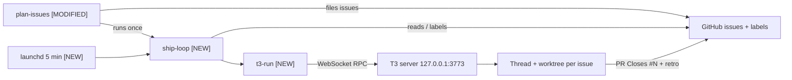

# Ship Loop: Plan Once, Agents Ship Every Issue — Design Specification

- **Date**: 2026-10-23
- **Status**: Approved in chat (sections 1–4), awaiting written-spec review
- **Branch**: `docs/ship-loop-design`
- **Replaces**: the manual `wma` hand-off and the per-repo setup steps (`init-agent-kit`, hand-written `AGENTS.md`) in the agent workflow guide

---

## 1. Goal

One conversation with a strong model (Opus 5.5) in any `ne1cc` repo turns into finished, documented PRs with no further hand-offs:

1. You review the repo with Opus and agree on the direction and the list of changes.
2. You approve the issue list. This is the only gate before work starts.
3. Every unblocked issue starts at once, each in its own T3 thread and worktree, on a cheap or strong model chosen by its label.
4. Each executor opens a PR (`Closes #N`) and posts a retrospective comment.
5. You review each PR (T3 Guide tab + retro), merge it, and delete the thread with its worktree.
6. Merging releases the issues that were blocked by it within 5 minutes.
7. When the last sub-issue closes, a strong model posts the roll-up retrospective on the epic and closes it.

No per-repo setup. No commands to remember between steps 2 and 5.

### Non-goals

- Repos outside the `ne1cc` owner.
- Detecting a stalled agent that never opens a PR.
- A cap on parallel runs.
- Cross-repo dependencies (`Blocked by owner/repo#N`).
- Automating PR review or merge.

---

## 2. Architecture

```text
YOU ── Opus thread in any repo ── "review this, I want X" … "file it"
plan-issues (changed)  files epic + sub-issues (exec:* label, "Blocked by #N" lines), then runs ship-loop once
bin/ship-loop (new)    one pass; also every 5 min via launchd; for every ne1cc repo with an open epic:
   ├─ sub-issue open, not shipped/ship-failed, all blockers closed → label shipped → t3-run (model from label)
   └─ epic: every sub-issue closed, no retro-posted → label retro-posted → t3-run (strong, retro prompt)
bin/t3-run (new)       token → project add if missing → upsert one-off task → runNow → delete task
T3 thread per issue    executor follows Issue-Driven Work: build → test → PR (Closes #N) → retrospective comment
YOU ── Guide tab + retro → merge → delete thread (+ worktree); next pass releases unblocked issues
```



### State

GitHub labels are the only state. Nothing is stored locally.

| Label | Set by | Meaning |
| :--- | :--- | :--- |
| `epic` | plan-issues | The plan; its sub-issues are the work |
| `exec:flash` | plan-issues | Run on GLM 5.3 Flash |
| `exec:strong` | plan-issues | Run on Sonnet 5.5 |
| `shipped` | ship-loop | A thread was started for this issue; never dispatch again |
| `ship-failed` | ship-loop | Dispatch failed; skipped until you remove the label |
| `retro-posted` | ship-loop | The epic roll-up run was started |

---

## 3. `plan-issues` changes

File: `.gemini/skills/plan-issues/SKILL.md`. The issue sections (Goal, Context, Scope, Acceptance criteria, Verify with, Dependencies) and the quality gate stay as they are.

| Part | Today | New |
| :--- | :--- | :--- |
| Preconditions | Templates, labels and a filled `AGENTS.md` must exist, else stop and run `init-agent-kit` | Only `gh auth status` works and the repo is at `~/Github/ne1cc/<repo>` |
| Labels | Must already exist | Created before filing with `gh label create --force` (all six labels; idempotent) |
| Issue structure | From the repo's template files | Written directly from the section list in the skill |
| "Verify with" commands | Copied from `AGENTS.md` | Planner runs each command once before filing. It must run; a failure is allowed only when the issue's change is what fixes it. Never run a command that deploys, migrates, or writes outside the repo; mark those "not pre-checked" in the issue |
| Missing `AGENTS.md` | Hard stop | Planner drafts one (Commands, Architecture ≤5 lines, Conventions, Do not touch) and files it as an ordinary `exec:flash` sub-issue with the full text in the body |
| Dependencies | `Blocked by #N` per blocker | Same syntax, now machine-read by ship-loop; blockers filed first so numbers are real |
| After filing | Reminder to hand off each issue | Runs `ship-loop --repo owner/repo` and reports "Shipping: N started, M waiting on #a, #b" |

`init-agent-kit` stays for repos that want the optional PR-body CI check; the workflow no longer needs it. The skill description gains a line saying planning works in any repo.

---

## 4. `bin/ship-loop` (bash, `gh`, `jq`)

```text
ship-loop [--repo owner/repo] [--dry-run]

pass:
  1. Lock: mkdir lock dir; already held → exit 0 (plan-issues and launchd can overlap)
  2. T3 server unreachable on 127.0.0.1:3773 → log, exit 0, label nothing, no notification
  3. Repos: --repo, else gh search issues --owner ne1cc --label epic --state open
  4. Repo not at ~/Github/ne1cc/<repo> → gh-ns-clone it
  5. For each open epic E:
       sub-issues = gh api repos/<o>/<r>/issues/E/sub_issues
       each open sub-issue without shipped / ship-failed:
         any "Blocked by #N" still open → wait
         no exec:* label → ship-failed + notification
         else → label shipped → t3-run <path> <tier> "#N <title>" "<executor prompt>"
                t3-run non-zero → remove shipped, add ship-failed, notification
       every sub-issue closed and no retro-posted → label retro-posted → t3-run <path> retro …
  6. Release lock
```

- **Executor prompt**: `Implement GitHub issue #N in owner/repo, following Issue-Driven Work.`
- **Retro prompt**: `Post the roll-up retrospective on epic #E in owner/repo: link each sub-issue PR and its retrospective, note what was kicked back and what each model did well or badly, then close the epic.`
- **Closed counts as done**: a blocker closed as "not planned" also releases its dependents.
- **Notification**: `osascript -e 'display notification …'`, once per failure, because `ship-failed` stops retries.
- **`--dry-run`**: prints every label change and dispatch without making them.

| Situation | Behavior |
| :--- | :--- |
| You request changes on a PR | Reply in that issue's T3 thread; the loop is not involved |
| You merge a PR | `Closes #N` closes the issue; next pass (≤5 min) releases dependents |
| You close an epic by hand | Ignored from then on (only open epics are read) |
| Retry a failed issue | Remove `ship-failed` in GitHub |

---

## 5. `bin/t3-run` (Node 24, built-in WebSocket, no dependencies)

```text
t3-run <repo-path> <exec:flash|exec:strong|retro> <title> <prompt>
```

1. Token: `t3 auth session issue`.
2. Project: `t3 project add <repo-path>` if the project is not listed.
3. `scheduledTasks.upsert`: one-off task, new worktree from `origin/main`, model for the tier, the prompt, the title.
4. `scheduledTasks.runNow`.
5. `scheduledTasks.delete` (or after the thread starts, if the spike shows delete-before-start cancels it).

Exit non-zero on any error. Model constants live at the top of the script: `exec:flash` → GLM 5.3 Flash, `exec:strong` and `retro` → Sonnet 5.5. Instance IDs and payload shapes come from the spike.

**Fallback** if the RPC route does not work: `t3-run` sends a "#N ready" notification and copies the prompt to the clipboard; you paste it into a new thread. ship-loop is unchanged.

---

## 6. launchd job

- `launchd/com.ne1cc.ship-loop.plist`: runs `bin/ship-loop` every 300 s, `PATH` includes `/opt/homebrew/bin`, logs to `~/Library/Logs/ship-loop.log`.
- `bin/link-agent-skills.sh` symlinks it into `~/Library/LaunchAgents/` and loads it (`launchctl bootstrap gui/$UID`) if not loaded; `--verify` checks it is loaded.
- Rollback: `launchctl bootout gui/$UID/com.ne1cc.ship-loop`.

---

## 7. Testing

| Piece | Test |
| :--- | :--- |
| ship-loop | `tests/ship-loop.test.sh`: stub `gh` and `t3-run` on `PATH` + JSON fixtures. Cases: blocked issue waits; unblocked issue ships; t3-run failure → `ship-failed`; closed epic gets its retro once; held lock exits 0 |
| t3-run | Spike + one live run (thin wrapper over 4 calls) |
| plan-issues | End-to-end trial |
| launchd | `link-agent-skills.sh --verify` |

---

## 8. Rollout (one branch, one PR, in order)

1. **Spike** (throwaway; asks first): issue a token, list projects/providers over WebSocket, upsert a "reply OK, change nothing" task in terminal-configs, `runNow`, confirm exactly one thread and one worktree appear, delete the task. Records payload shapes, model instance IDs, the worktree-from-`origin/main` setting, and delete-after-run behavior.
2. `bin/t3-run` from the spike's findings.
3. `bin/ship-loop` + `tests/ship-loop.test.sh`.
4. `plan-issues` changes.
5. launchd plist + `link-agent-skills.sh` wiring.
6. **End-to-end trial** (asks first): new private `ne1cc/agent-sandbox` repo, epic with issues A and B where B is `Blocked by` A. Pass when A dispatches at once, B waits, merging A releases B within 5 min, and merging B triggers the roll-up retro and closes the epic.
7. Enable the timer only after the trial passes.
8. Rewrite the agent workflow guide: drop `wma` and per-repo setup.

---

## 9. Risks

| Risk | Mitigation |
| :--- | :--- |
| T3 RPC is undocumented and may change between versions (bundle 0.1.1, server 0.1.2) | t3-run fails loud → `ship-failed`; notify-only fallback |
| Private repos may not inherit templates from public `ne1cc/.github` | plan-issues writes sections itself; templates not required |
| A wrong `Blocked by` line starts an issue early | Planner files blockers first; you approve the list before filing |
| Many issues start at once and cost adds up | You see the count when approving; add a cap later if needed |
