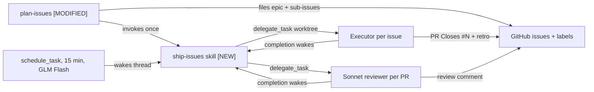

# Ship Issues: Plan Once, T3 Orchestrates Every Issue — Design Specification

- **Date**: 2026-10-23 (revised same day: T3-native orchestration replaces the launchd/RPC design)
- **Status**: Approved in chat, awaiting written-spec review
- **Branch**: `docs/ship-loop-design`
- **Replaces**: the manual `wma` hand-off and the per-repo setup steps (`init-agent-kit`, hand-written `AGENTS.md`) in the agent workflow guide

---

## 1. Goal

One conversation with a strong model (Opus 5.5) in any `ne1cc` repo turns into reviewed, documented PRs with no further hand-offs:

1. You review the repo with Opus and agree on the direction and the list of changes.
2. You approve the issue list. This is the only gate before work starts.
3. The same thread becomes the orchestrator. Every unblocked issue starts at once as a T3 delegated task in its own worktree, on the model its label names.
4. Each executor opens a PR (`Closes #N`) with a retrospective comment.
5. A Sonnet 5.5 reviewer reviews each PR. Up to two automatic fix rounds; then the PR is yours.
6. You merge. The orchestrator notices within 15 minutes and starts the issues that merge unblocked.
7. When the last sub-issue closes, the orchestrator posts the roll-up retrospective, closes the epic and turns its schedule off.

### Non-goals

- Repos outside the `ne1cc` owner.
- Automatic merging.
- Cross-repo dependencies.
- A cap on parallel tasks.

---

## 2. Why T3-native

T3 gives every agent thread orchestration tools. A live loop in `ne1cc/cti-dashboard` already uses them (83 scheduled wakes, delegated fix and review tasks). Building our own dispatcher would duplicate them.

| Need | T3 tool |
| :--- | :--- |
| Start a child in its own worktree on a chosen model | `delegate_task` with `isolation: "worktree"`, `target: {providerInstanceId, model, options}`, `mode: "async"`, stable `clientRequestId` |
| Find the model IDs | `orchestrator_capabilities` |
| Know when a child finishes | Automatic: T3 wakes the parent thread; `task_status` to read the result |
| Notice merges between child completions | `schedule_task` bound to the current thread (interval) |
| Show PRs in the T3 PR panel and Guide tab | `link_pull_request` |

Lessons taken from the CTI loop:

- Its wake prompt was a 6.7 KB one-off written by an agent. Here the wake prompt is one line that runs a skill, so every repo behaves the same.
- It woke at gpt-6.1-sol xhigh every 15 minutes, mostly to find nothing. Here scheduled wakes run on GLM 5.3 Flash.
- It kept state in a `.scratch` ledger inside one worktree. Here state is GitHub labels, visible anywhere and safe across thread restarts.
- It capped itself at one active task. Here every unblocked issue runs in parallel.

Dropped from the earlier design: `bin/ship-loop`, `bin/t3-run`, the launchd job and the RPC spike.

---

## 3. Pieces



| Piece | Change |
| :--- | :--- |
| `.gemini/skills/plan-issues/SKILL.md` | Zero-setup preconditions, creates labels, proven verify commands, then invokes `ship-issues` |
| `.gemini/skills/ship-issues/SKILL.md` | New: one orchestration pass, safe to run any number of times |
| `bin/link-agent-skills.sh` | No change: it already links every folder under `.gemini/skills` to all runtimes |

### State

| Label | On | Set by | Meaning |
| :--- | :--- | :--- | :--- |
| `epic` | issue | plan-issues | The plan |
| `exec:flash` / `exec:strong` | issue | plan-issues | Executor model: GLM 5.3 Flash / Sonnet 5.5 |
| `shipped` | issue | ship-issues | Executor delegated; never delegate again |
| `ship-failed` | issue or epic | ship-issues | Delegation failed; skipped until you remove it |
| `ai-reviewed` | PR | ship-issues | Reviewer delegated for the PR's current head |
| `retro-posted` | epic | ship-issues | Roll-up retro done |

Review rounds are counted from PR comments that start with `AI review round`.

---

## 4. `plan-issues` changes

The issue sections (Goal, Context, Scope, Acceptance criteria, Verify with, Dependencies) and the quality gate stay as they are.

| Part | Today | New |
| :--- | :--- | :--- |
| Preconditions | Templates, labels and a filled `AGENTS.md` must exist, else stop and run `init-agent-kit` | Only `gh auth status` works |
| Labels | Must already exist | Created before filing with `gh label create --force` (all seven; idempotent) |
| Issue structure | From the repo's template files | Written from the section list in the skill |
| "Verify with" commands | Copied from `AGENTS.md` | Run once before filing. Must run; may fail only where the issue's change fixes it. Never run deploy, migrate, or outside-the-repo commands; mark those "(not pre-checked)" |
| Missing `AGENTS.md` | Hard stop | Drafted and filed as an ordinary `exec:flash` sub-issue with the full text |
| Dependencies | `Blocked by #N` | Same, machine-read by ship-issues; blockers filed first |
| After filing | Reminder to hand off | Invoke `ship-issues` for the new epic |

---

## 5. `ship-issues` pass

Invoked by plan-issues, by the schedule (prompt: `Use the ship-issues skill for epic #E in owner/repo.`), by T3 when a child finishes, or by you. Every pass reads GitHub fresh and acts only on what changed, so repeated or overlapping wakes cannot duplicate work.

```text
1. Read epic E, its sub-issues (gh api …/issues/E/sub_issues), labels, and PRs whose body has "Closes #N"
2. Schedule: none bound to this thread for E → schedule_task (interval 15 min, GLM 5.3 Flash, wake prompt above)
3. Each open sub-issue without shipped / ship-failed, every "Blocked by #N" closed:
     no exec:* label → ship-failed
     else → label shipped → delegate_task (isolation worktree, async, model from label, executor brief)
     delegation error → swap shipped for ship-failed, say so in the thread
4. Each open PR for a sub-issue, no ai-reviewed → label ai-reviewed → delegate_task reviewer (Sonnet 5.5)
5. Finished reviewer said CHANGES and rounds < 2 → delegate fixer (issue's model) on the PR branch;
   when the fixer pushes, remove ai-reviewed so step 4 reviews the new head
   APPROVE, or 2 rounds done → post "Ready for you: PR #P" in the thread
6. Every sub-issue closed and no retro-posted → write and post the roll-up on E, label retro-posted,
   close E, disable the schedule
7. Nothing changed → end the turn with no message
```

- **Executor brief** (`delegate_task.task`): the full issue body, then: `Implement GitHub issue #N in owner/repo following the Issue-Driven Work section of your instructions: one branch, PR body starts "Closes #N", fill every PR template section, post the retrospective comment, call link_pull_request. Return the PR URL, retro comment URL and head SHA. Do not watch or poll the PR.`
- **Reviewer brief**: PR URL, the issue body, `gh pr diff`. Post one PR comment starting `AI review round <k>: APPROVE` or `AI review round <k>: CHANGES` followed by numbered findings tied to the issue's acceptance criteria. Change no code.
- **Fixer brief**: PR URL, the issue body, every `AI review round` comment. `gh pr checkout <P>`, address each finding or reply why not, push to the same branch, return the new head SHA.
- **Base commit**: delegated worktrees start from the parent thread's local commit. Executors fetch and rebase onto `origin/main` first (Worktree Git Sync rule), so a stale parent is harmless.
- **Models**: resolve `providerInstanceId` and `model` for GLM 5.3 Flash and Sonnet 5.5 from `orchestrator_capabilities` each pass; never hardcode IDs.

| Situation | Behavior |
| :--- | :--- |
| You want changes on a PR yourself | Comment on the PR and reply in the executor's child thread, or ask the orchestrator for a fix round |
| You close the epic by hand | Next wake sees it closed and disables the schedule |
| Thread deleted | The schedule bound to it stops; run `/ship-issues owner/repo#E` from a new thread to resume (labels hold the state) |
| Retry a failed issue | Remove `ship-failed`; the next pass picks it up |

---

## 6. Testing

| Piece | Test |
| :--- | :--- |
| Skills | `rg` checks that required phrases exist and old ones are gone; `bin/link-agent-skills.sh --verify` passes and `~/.claude/skills/ship-issues` resolves |
| Whole loop | End-to-end trial (below) |

There is no new code, so no unit tests.

---

## 7. Rollout

1. Write `ship-issues`, change `plan-issues`, run `bin/link-agent-skills.sh`.
2. **End-to-end trial** (asks first): new private `ne1cc/agent-sandbox`, epic with A and B where B is `Blocked by` A. Pass when: A starts at once and B waits; A's PR gets a reviewer comment; merging A starts B within 15 minutes; merging B produces the roll-up, closes the epic and disables the schedule.
3. Rewrite the agent workflow guide: drop `wma` and per-repo setup.

---

## 8. Risks

| Risk | Mitigation |
| :--- | :--- |
| Child-completion wakes run on the thread's own model (Opus) | Few and only on real events; switch the thread to Sonnet after filing if cost matters |
| Orchestration tool names or arguments change in a T3 update | The skill names intents; agents read live tool schemas; the trial catches breakage |
| A wrong `Blocked by` line starts an issue early | Blockers filed first; you approve the list before filing |
| Many issues at once cost more | You see the count when approving |
| Private repos may not inherit `ne1cc/.github` templates | plan-issues writes sections itself |
